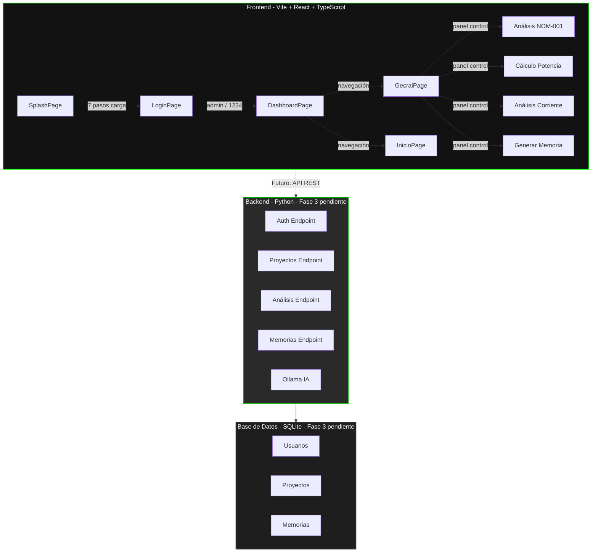

# 🎯 GECRAI - Sistema Inteligente para Memorias de Cálculo Eléctrico

Demo web del sistema **GECRAI v1.1 Pro** - Sistema Inteligente para Memorias de Cálculo Eléctrico, desarrollado por **GProA Technology**.

---

## 📂 Estructura del Proyecto

```
GECRAI/
│
├── frontend/                 # Frontend moderno (Vite + React + TypeScript)
│   ├── src/
│   │   ├── pages/            # Páginas: Splash, Login, Dashboard, Gecrai, Inicio, Error
│   │   ├── components/       # Componentes reutilizables (ProtectedRoute)
│   │   ├── types/            # Interfaces TypeScript
│   │   ├── App.tsx           # Router con react-router-dom
│   │   ├── main.tsx          # Punto de entrada React
│   │   └── index.css         # Estilos con tema GECRAI (oscuro, verde #00ff00)
│   ├── package.json
│   ├── vite.config.ts
│   └── index.html
│
├── logs/                     # Logs de ejecución (frontend.log, backend.log)
│   ├── frontend.log
│   └── backend.log
│
├── start-gecrai.ps1          # Script interactivo de PowerShell para levantar el sistema
├── README.md
├── LICENSE
└── .git/
```

---

## 🏗️ Arquitectura del Sistema



---

## 🚀 Cómo Iniciar el Sistema

### Usando el script interactivo de PowerShell (Recomendado)

```powershell
# Cambiar a codificación UTF-8 para evitar caracteres raros
chcp 65001

# Navegar al directorio del proyecto
cd "C:\Users\X1\OneDrive\Documentos\Python_VS Code\GProA\GECRAI"

# Ejecutar el script interactivo
.\start-gecrai.ps1
```

El script muestra un menú con las siguientes opciones:

| Opción | Acción |
|--------|--------|
| 1 | Levantar solo el Frontend (Vite + React en `http://localhost:5173`) |
| 2 | Levantar solo el Backend (Python) |
| 3 | Levantar todo (Frontend + Backend) |
| 4 | Detener todos los procesos |
| 5 | Ver estado actual de los procesos |
| 6 | Ver logs recientes |
| 7 | Limpiar logs |
| 8 | Verificar prerrequisitos |
| 9 | Diagnosticar frontend (puerto 5173) |
| 0 | Salir |

### Requisitos

- Node.js v24.x+
- npm v11.x+
- Python 3.x+

---

## 🖥️ Frontend (Disponible Ahora)

El frontend está listo para usar con las siguientes pantallas:

| Pantalla | Ruta | Descripción |
|----------|------|-------------|
| Splash | `/` o `/splash` | Animación de carga de 7 pasos, redirige a Login |
| Login | `/login` | Autenticación simulada (`admin` / `1234`) |
| Dashboard | `/dashboard` | Estadísticas, proyectos recientes, actividad |
| Asistente GECRAI | `/gecrai` | Panel de control (conexión a Ollama pendiente) |
| Inicio | `/inicio` | Bienvenida y opciones del sistema |
| Error | `*` | Página 404 con enlace de regreso |

### Credenciales de prueba

- **Usuario:** `admin`
- **Contraseña:** `1234`

---

## 🔧 Backend (Fase 3 - Pendiente)

El backend en Python se construirá en la Fase 3 e incluirá:

- **FastAPI o Flask** con endpoints REST
- **Autenticación real** (reemplazará la simulación actual)
- **Motor de cálculos eléctricos** (NOM-001, potencia, corriente, protecciones)
- **Base de datos SQLite** para persistencia de proyectos y usuarios
- **Generación de memorias de cálculo** (PDF/Excel)
- **Integración con Ollama** para el asistente inteligente

Cuando esté listo, Swagger estará disponible en `/docs` para probar el backend sin el frontend.

---

## 🗓️ Fase 3 - Plan de Sprints (Backend Python)

El backend se construirá por sprints para ir entregando valor incremental. Cada sprint tiene un objetivo claro y criterios de aceptación.

### Estructura del Backend

```
backend/
├── main.py                 # Entrypoint FastAPI
├── requirements.txt        # Dependencias Python
├── app/
│   ├── __init__.py
│   ├── main.py             # Configuración de la app y rutas
│   ├── api/
│   │   ├── __init__.py
│   │   ├── auth.py         # Endpoints de autenticación
│   │   ├── calculations.py # Cálculos NOM-001 (nom-001 endpoint)
│   │   ├── memories.py     # CRUD de memorias de cálculo
│   │   ├── metrics.py      # Métricas del dashboard
│   │   └── ollama.py       # Integración con Ollama (asistente IA)
│   ├── core/
│   │   ├── __init__.py
│   │   ├── config.py       # Configuración (puerto, host, Ollama URL)
│   │   ├── database.py     # Conexión SQLite
│   │   └── security.py     # Hash de passwords, JWT tokens
│   ├── models/
│   │   ├── __init__.py
│   │   ├── user.py         # Modelo de usuario
│   │   ├── memory.py       # Modelo de memoria de cálculo
│   │   └── project.py      # Modelo de proyecto
│   ├── schemas/
│   │   ├── __init__.py
│   │   ├── auth.py         # Schemas de login/registro
│   │   ├── calculation.py  # Schemas de entrada/salida de cálculos
│   │   └── memory.py       # Schemas de memorias
│   └── services/
│       ├── __init__.py
│       ├── calc_service.py # Motor de cálculos (adaptado de calculo.js a Python)
│       └── ollama_service.py # Cliente para Ollama
├── tests/
│   └── test_calculations.py
├── gecrais.db              # SQLite (se crea automáticamente)
└── .env                    # Variables de entorno (no commitear)
```

### Sprint 3.1 — Setup del Proyecto FastAPI

**Objetivo:** Levantar el esqueleto del backend con FastAPI configurado y corriendo.

**Tareas:**
- [ ] Crear `backend/` dentro de `GECRAI/`
- [ ] Crear `requirements.txt` con FastAPI, Uvicorn, SQLAlchemy, python-jose, passlib, python-multipart
- [ ] Crear `main.py` con configuración básica de FastAPI
- [ ] Configurar CORS para permitir conexiones desde `http://localhost:5173`
- [ ] Verificar que el servidor levante en `http://localhost:8000`
- [ ] Verificar que Swagger esté disponible en `http://localhost:8000/docs`

**Criterios de aceptación:**
- `npm run dev` del frontend y `python main.py` del backend pueden correr en paralelo
- Acceder a `http://localhost:8000/docs` muestra la documentación de la API vacía

---

### Sprint 3.2 — Base de Datos SQLite + Modelos

**Objetivo:** Establecer la capa de persistencia con SQLite y SQLAlchemy.

**Tareas:**
- [ ] Crear `app/core/database.py` con motor SQLite y sesión
- [ ] Crear modelos: `User`, `Project`, `Memory`
- [ ] Crear esquemas Pydantic para cada modelo
- [ ] Implementar inicialización de tablas al arrancar la app
- [ ] Script de semilla con usuario demo (`admin` / `1234` hasheado)

**Criterios de aceptación:**
- Al iniciar el backend se crea `gecrais.db` automáticamente
- Se puede consultar la base de datos con un cliente SQLite

---

### Sprint 3.3 — Autenticación Real

**Objetivo:** Reemplazar la autenticación simulada (`admin`/`1234` en localStorage) por un sistema real con JWT.

**Tareas:**
- [ ] Crear `app/core/security.py` con hash de passwords (passlib) y JWT (python-jose)
- [ ] Crear `app/api/auth.py` con endpoints:
  - `POST /api/auth/register`
  - `POST /api/auth/login`
  - `GET /api/auth/me`
- [ ] Middleware de protección de rutas con JWT
- [ ] Actualizar frontend `LoginPage.tsx` para llamar al endpoint real
- [ ] Guardar token JWT en `localStorage` en lugar de simulado

**Criterios de aceptación:**
- El login falla con credenciales incorrectas
- El token JWT se guarda y se envía en las cabeceras de las siguientes peticiones
- Las rutas protegidas devuelven 401 sin token válido

---

### Sprint 3.4 — Motor de Cálculos Eléctricos (NOM-001)

**Objetivo:** Adaptar el motor de cálculos de `calculo.js` (demo enterprise de la web) a Python.

**Tareas:**
- [ ] Crear `app/services/calc_service.py` adaptando `calculo.js`:
  - Tablas 430-250 (trifásico), 430-248 (monofásico), 430-249 (bifásico)
  - Cálculo de Ipc, Im, Id
  - Selección de calibre por ampacidad, caída de tensión, interruptor, calibre a tierra
  - Calibre sugerido
- [ ] Crear `app/api/calculations.py` con endpoint:
  - `POST /api/calcular/nom-001`
- [ ] Crear esquemas de entrada/salida en `app/schemas/calculation.py`
- [ ] Pruebas unitarias en `tests/test_calculations.py` (caso 20 HP / 440 V / 3F)

**Criterios de aceptación:**
- El caso de referencia (20 HP, 440V, 3F, L=0.07km) devuelve: Ipc=27A, Im=33.75A, calibre 8 AWG, interruptor 40A
- Los cálculos coinciden con la memoria de cálculo de referencia (Excel)

---

### Sprint 3.5 — Endpoints de Memorias y Dashboard

**Objetivo:** Persistencia de memorias de cálculo y métricas para el dashboard.

**Tareas:**
- [ ] Crear `app/api/memories.py` con endpoints:
  - `POST /api/memorias` — crear memoria
  - `GET /api/memorias` — listar memorias (ordenadas por fecha)
  - `GET /api/memorias/{id}` — obtener memoria por ID
- [ ] Crear `app/api/metrics.py` con endpoint:
  - `GET /api/metrics/dashboard` — métricas (proyectos activos, análisis, memorias, usuarios)
- [ ] Conectar frontend `DashboardPage.tsx` y `GecraiPage.tsx` a estos endpoints
- [ ] Reemplazar datos estáticos/mock por datos reales de la API

**Criterios de aceptación:**
- Se puede crear una memoria desde el asistente GECRAI y se persiste
- El dashboard muestra datos reales de la base de datos
- Al recargar la página, las memorias creadas previamente siguen ahí

---

### Sprint 3.6 — Integración con Ollama (Asistente IA)

**Objetivo:** Conectar el chat del asistente GECRAI con Ollama local.

**Tareas:**
- [ ] Crear `app/services/ollama_service.py` con cliente para Ollama (`http://localhost:11434`)
- [ ] Crear `app/api/ollama.py` con endpoint:
  - `POST /api/ai/chat` — recibe mensaje del usuario, devuelve respuesta de Ollama
- [ ] Conectar frontend `GecraiPage.tsx` chat al endpoint real
- [ ] Sistema de fallback si Ollama no está disponible (respuesta simulada)
- [ ] Contexto de conversación: enviar historial de mensajes a Ollama

**Criterios de aceptación:**
- Ollama instalado y corriendo localmente con un modelo (ej. `ollama pull llama3`)
- El chat del asistente responde con IA real cuando Ollama está disponible
- Si Ollama está caído, se muestra un mensaje amigable y respuesta simulada

---

### Sprint 3.7 — Pruebas e Integración Completa

**Objetivo:** Verificar que todo el sistema funcione junto y documentar.

**Tareas:**
- [ ] Conectar frontend React con backend Python (cambiar URLs de `api.gecrai.com` a `http://localhost:8000`)
- [ ] Probar flujo completo: registro → login → dashboard → asistente → calcular → guardar memoria
- [ ] Ejecutar `npm run build` del frontend y verificar que no haya errores
- [ ] Ejecutar pruebas unitarias del backend (`pytest tests/`)
- [ ] Documentar variables de entorno en `.env.example`
- [ ] Actualizar `start-gecrai.ps1` con la opción de levantar el backend

**Criterios de aceptación:**
- El flujo completo funciona sin errores de consola
- Swagger en `/docs` permite probar todos los endpoints de forma independiente
- El sistema está listo para uso en desarrollo local

---

### Tecnologías Recomendadas

| Capa | Tecnología | Versión |
|------|------------|---------|
| Framework | FastAPI | 0.100+ |
| Servidor ASGI | Uvicorn | latest |
| ORM | SQLAlchemy | 2.0+ |
| Base de datos | SQLite | local |
| Auth | python-jose + passlib | latest |
| Validación de datos | Pydantic | v2 |
| IA local | Ollama | cualquier con modelo `llama3` o `gemma` |
| Pruebas | pytest | latest |

### Cómo Ejecutar el Backend (una vez implementado)

```powershell
cd backend
python -m venv venv
.\venv\Scripts\Activate.ps1
pip install -r requirements.txt
python main.py
```

El servidor estará en `http://localhost:8000` y Swagger en `http://localhost:8000/docs`.

---


## 🎨 Diseño Visual

- **Tema:** Oscuro con acentos verdes (`#00ff00`)
- **Tipografía:** Helvetica, Arial, sans-serif
- **Estado:** Bastidor funcional (estructura y colores base, pulido visual pendiente)

---

## 📋 Funcionalidades Actuales

- ✅ Navegación entre 6 pantallas con React Router
- ✅ Autenticación simulada con `localStorage`
- ✅ Rutas protegidas (requieren sesión activa)
- ✅ Animación de splash con progreso de 7 pasos
- ✅ Dashboard con tarjetas de estadísticas
- ✅ Panel de control del asistente (opciones de análisis)
- ✅ Script interactivo de PowerShell con diagnóstico de puerto 5173

---

## 🔐 Seguridad

- No incluir archivos sensibles en el repositorio
- Verificar que todos los archivos sean necesarios
- Mantener una estructura limpia y organizada

---

**Desarrollado por GProA Technology** - Sistema Inteligente para Memorias de Cálculo Eléctrico
