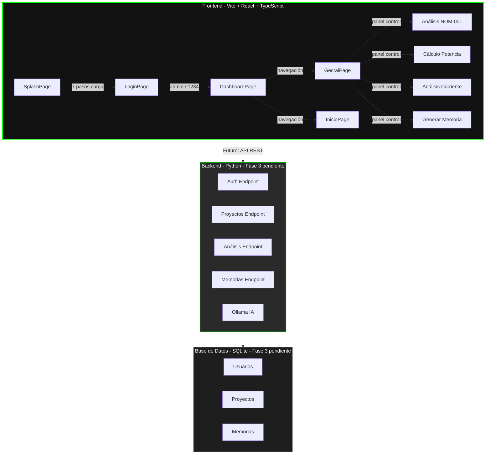

# 🎯 GECRAI - Sistema Inteligente para Memorias de Cálculo Eléctrico

Demo web del sistema **GECRAI v1.1 Pro** - Sistema Inteligente para Memorias de Cálculo Eléctrico, desarrollado por **GProA Technology**.

---

## 📂 Estructura del Proyecto

```
GECRAI/
│
├── frontend/                 # Frontend moderno (Vite + React + TypeScript)
│   ├── src/
│   │   ├── pages/            # Páginas: Splash, Login, Dashboard, Gecrai, Inicio, Error
│   │   ├── components/       # Componentes reutilizables (ProtectedRoute)
│   │   ├── types/            # Interfaces TypeScript
│   │   ├── App.tsx           # Router con react-router-dom
│   │   ├── main.tsx          # Punto de entrada React
│   │   └── index.css         # Estilos con tema GECRAI (oscuro, verde #00ff00)
│   ├── package.json
│   ├── vite.config.ts
│   └── index.html
│
├── logs/                     # Logs de ejecución (frontend.log, backend.log)
│   ├── frontend.log
│   └── backend.log
│
├── start-gecrai.ps1          # Script interactivo de PowerShell para levantar el sistema
├── README.md
├── LICENSE
└── .git/
```

---

## 🏗️ Arquitectura del Sistema



---

## 🚀 Cómo Iniciar el Sistema

### Usando el script interactivo de PowerShell (Recomendado)

```powershell
# Cambiar a codificación UTF-8 para evitar caracteres raros
chcp 65001

# Navegar al directorio del proyecto
cd "C:\Users\X1\OneDrive\Documentos\Python_VS Code\GProA\GECRAI"

# Ejecutar el script interactivo
.\start-gecrai.ps1
```

El script muestra un menú con las siguientes opciones:

| Opción | Acción |
|--------|--------|
| 1 | Levantar solo el Frontend (Vite + React en `http://localhost:5173`) |
| 2 | Levantar solo el Backend (Python) |
| 3 | Levantar todo (Frontend + Backend) |
| 4 | Detener todos los procesos |
| 5 | Ver estado actual de los procesos |
| 6 | Ver logs recientes |
| 7 | Limpiar logs |
| 8 | Verificar prerrequisitos |
| 9 | Diagnosticar frontend (puerto 5173) |
| 0 | Salir |

### Requisitos

- Node.js v24.x+
- npm v11.x+
- Python 3.x+

---

## 🖥️ Frontend (Disponible Ahora)

El frontend está listo para usar con las siguientes pantallas:

| Pantalla | Ruta | Descripción |
|----------|------|-------------|
| Splash | `/` o `/splash` | Animación de carga de 7 pasos, redirige a Login |
| Login | `/login` | Autenticación simulada (`admin` / `1234`) |
| Dashboard | `/dashboard` | Estadísticas, proyectos recientes, actividad |
| Asistente GECRAI | `/gecrai` | Panel de control (conexión a Ollama pendiente) |
| Inicio | `/inicio` | Bienvenida y opciones del sistema |
| Error | `*` | Página 404 con enlace de regreso |

### Credenciales de prueba

- **Usuario:** `admin`
- **Contraseña:** `1234`

---

## 🔧 Backend (Fase 3 - Completado)

El backend en Python está implementado con FastAPI e incluye:

- **FastAPI** con endpoints REST y Swagger en `/docs`
- **Autenticación real** con JWT (login, registro, rutas protegidas)
- **Motor de cálculos eléctricos** (NOM-001, potencia, corriente, protecciones)
- **Base de datos SQLite** para persistencia de proyectos y usuarios
- **Endpoints de memorias** (CRUD completo)
- **Métricas del dashboard**
- **Asistente IA demo** (respuestas simuladas; conexión a Ollama pendiente)

### Endpoints disponibles

| Endpoint | Método | Descripción |
|----------|--------|-------------|
| `/` | GET | Información del servicio |
| `/health` | GET | Estado del servidor |
| `/docs` | GET | Documentación Swagger |
| `/auth/login` | POST | Autenticación JWT |
| `/auth/register` | POST | Registro de usuario |
| `/auth/me` | GET | Usuario autenticado actual |
| `/calcular/nom-001` | POST | Cálculos eléctricos NOM-001 |
| `/memorias/` | GET | Listar memorias de cálculo |
| `/memorias/` | POST | Crear memoria de cálculo |
| `/memorias/{id}` | GET | Obtener memoria por ID |
| `/metrics/dashboard` | GET | Métricas del dashboard |
| `/ai/chat` | POST | Asistente IA (demo simulado) |
| `/documentos/generar/pdf` | POST | Generar memoria en PDF |
| `/documentos/generar/excel` | POST | Generar memoria en Excel |
| `/documentos/{nombre}` | GET | Descargar documento |
| `/documentos/` | GET | Listar documentos generados |
| `/documentos/{nombre}` | DELETE | Eliminar documento |

### Credenciales de prueba

- **Usuario:** `admin`
- **Contraseña:** `1234`

---

## 🗓️ Estado de Sprints Completados

### Fase 1 — Auditoría y Limpieza Frontend Legacy ✅
- Auditoría del frontend legacy (duplicados, rutas, problemas)
- Eliminación de contenido legacy (raíz: splash.html, Templates/, Js/, CSS/, Assets/)
- Eliminación de basura (desktop.ini, gecrai.appcache)
- Normalización de rutas (absolutas → relativas)

### Fase 2 — Migración a Vite + React + TypeScript ✅
- Setup Vite + React + TypeScript + CSS plano
- Pantallas: Splash, Login, Dashboard, Asistente GECRAI, Inicio, Error
- ProtectedRoute, tipos TypeScript, estructura de carpetas

### Fase 3 — Backend Python ✅

| Sprint | Estado | Descripción |
|--------|--------|-------------|
| 3.1 | ✅ | Setup FastAPI, estructura base, CORS, Swagger |
| 3.2a | ✅ | Base de datos SQLite, modelos User/Project/Memory |
| 3.2b | ✅ | Autenticación JWT, login, registro, rutas protegidas |
| 3.3a | ✅ | Endpoints de memorias (CRUD): POST/GET /api/memorias |
| 3.3b | ✅ | Métricas de dashboard: GET /api/metrics/dashboard |
| 3.4 | ✅ | Motor de cálculos NOM-001: POST /api/calcular/nom-001 |
| 3.5 | ✅ | Chat demo GECRAI: POST /api/ai/chat (respuestas simuladas) |
| 3.6 | ✅ | Pruebas e integración completa (frontend + backend) |

### Fase 4 — Diseño Visual Frontend ✅

| Sprint | Estado | Descripción |
|--------|--------|-------------|
| 4.1.1 | ✅ | Estructura base: Navbar, Layout, LayoutCard, ButtonGecrai, InputGecrai, Logo, CSS base |
| 4.1.2 | ✅ | Pantallas de autenticación: Splash y Login con animación profesional |
| 4.1.3.1 | ✅ | Dashboard rediseñado: estadísticas, proyectos, actividad, acciones rápidas |
| 4.1.3.2 | ✅ | Inicio rediseñado: bienvenida, acciones rápidas, información del sistema |
| 4.1.3.3 | ✅ | Error 404 rediseñado |
| 4.1.4.1 | ✅ | Asistente GECRAI - Panel de Control con opciones de análisis |
| 4.1.4.2 | ✅ | Asistente GECRAI - Área de Chat conectada al backend /api/ai/chat |
| 4.1.4.4 | ✅ | Pulido global y responsive final (tipografía, contraste, accesibilidad, mobile) |

---

## 🎨 Diseño Visual (Completado)

- **Tema:** Oscuro con acentos verdes (`#00ff00`)
- **Tipografía:** Helvetica, Arial, sans-serif
- **Estado:** Completo (todas las pantallas rediseñadas con Layout, componentes reutilizables y responsive)

### Pantallas disponibles

| Pantalla | Ruta | Descripción |
|----------|------|-------------|
| Splash | `/` o `/splash` | Animación de carga de 7 pasos, redirige a Login |
| Login | `/login` | Autenticación (`admin` / `1234`) |
| Dashboard | `/dashboard` | Estadísticas, proyectos recientes, actividad, acciones rápidas |
| Asistente GECRAI | `/gecrai` | Panel de control y chat conectado al backend |
| Inicio | `/inicio` | Bienvenida, acciones rápidas, información del sistema |
| Error | `*` | Página 404 con enlace de regreso |

---

## 📋 Funcionalidades Implementadas

- ✅ Navegación entre 6 pantallas con React Router
- ✅ Autenticación con JWT (login, registro, rutas protegidas)
- ✅ Rutas protegidas (requieren sesión activa)
- ✅ Animación de splash con progreso de 7 pasos
- ✅ Dashboard con tarjetas de estadísticas, proyectos y actividad
- ✅ Panel de control del asistente con opciones de análisis (NOM-001, Potencia, Corriente, Memoria)
- ✅ Chat del asistente conectado al backend
- ✅ Motor de cálculos eléctricos NOM-001 (IPC, Im, Id, calibre, caída de tensión, interruptor, calibre a tierra)
- ✅ Persistencia de memorias de cálculo en SQLite
- ✅ Métricas del dashboard
- ✅ Script interactivo de PowerShell con diagnóstico de puertos y logs
- ✅ Diseño responsivo para móvil y desktop

---

## 📄 Generación de Memorias de Cálculo (PDF y Excel)

GECRAI permite generar memorias de cálculo eléctrico en formato PDF y Excel directamente desde la interfaz o mediante la API.

### Endpoints de generación

| Endpoint | Método | Descripción |
|----------|--------|-------------|
| `/api/documentos/generar/pdf` | POST | Genera memoria de cálculo en formato PDF |
| `/api/documentos/generar/excel` | POST | Genera memoria de cálculo en formato Excel |
| `/api/documentos/{nombre}` | GET | Descarga un documento generado |
| `/api/documentos/` | GET | Lista todas las memorias generadas |
| `/api/documentos/{nombre}` | DELETE | Elimina un documento generado |

### Parámetros de entrada

El cuerpo de la petición acepta los siguientes campos:

| Campo | Tipo | Requerido | Descripción |
|-------|------|-----------|-------------|
| `proyecto` | string | Sí | Nombre del proyecto |
| `tag` | string | No | Etiqueta del proyecto |
| `normativa` | string | No | Normativa aplicable (default: NOM-001-SEDE-2012) |
| `voltaje` | number | Sí | Voltaje del sistema en voltios |
| `corriente` | number | Sí | Corriente en amperios |
| `potencia` | number | Sí | Potencia en HP |
| `fp` | number | Sí | Factor de potencia (0-1) |
| `longitud` | number | Sí | Longitud en kilómetros |
| `temperaturaAmbiente` | number | No | Temperatura ambiente en °C |
| `temperaturaCable` | number | No | Temperatura del cable en °C |
| `tipoConductor` | string | No | Tipo de conductor |
| `hilosPorFase` | number | No | Hilos por fase |
| `canalizacion` | string | No | Tipo de canalización |
| `cantidadConductores` | number | No | Cantidad de conductores |
| `porcentajeVcDeseado` | number | No | Porcentaje de caída deseada |
| `eficiencia` | number | No | Eficiencia del motor |
| `r` | number | No | Resistencia del conductor |
| `xl` | number | No | Reactancia del conductor |
| `resultado` | object | No | Resultado del cálculo eléctrico |
| `owner_id` | number | No | ID del usuario propietario |
| `project_id` | number | No | ID del proyecto asociado |

### Ejemplo de uso (curl)

```bash
# Generar PDF
curl -X POST http://localhost:8000/api/documentos/generar/pdf \
  -H "Content-Type: application/json" \
  -d '{"proyecto": "Planta Industrial", "voltaje": 440, "corriente": 27, "potencia": 20, "fp": 0.85, "longitud": 0.07, "owner_id": 1}'

# Generar Excel
curl -X POST http://localhost:8000/api/documentos/generar/excel \
  -H "Content-Type: application/json" \
  -d '{"proyecto": "Centro Comercial", "voltaje": 220, "corriente": 15, "potencia": 15, "fp": 0.90, "longitud": 0.15, "owner_id": 1}'

# Descargar documento
curl -O http://localhost:8000/api/documentos/memoria_GECRAI-20261103-0001.pdf
```

### Características de los documentos generados

- **PDF**: Pantalla profesional con logo GECRAI, número de memoria, fecha, tabla completa de parámetros y estado de aprobación
- **Excel**: Hoja de cálculo formateada con encabezados, colores de GECRAI y datos organizados en filas y columnas
- **Tema oscuro**: Colores consistentes con la identidad visual de GECRAI (oscuro con verde `#00ff00`)
- **Número de memoria único**: Formato `GECRAI-YYYYMMDD-XXXX`

---

## 🚀 Próximos Pasos (Pendientes)

1. **Conexión real a Ollama:** Instalar Ollama en el servidor y conectar el chat al endpoint `/api/ai/chat` para respuestas de IA reales (actualmente usa respuestas simuladas).
2. **Tests unitarios:** Expandir cobertura de pruebas unitarias a todos los módulos del backend y frontend.

---


## 🔐 Seguridad

- No incluir archivos sensibles en el repositorio
- Verificar que todos los archivos sean necesarios
- Mantener una estructura limpia y organizada

---

**Desarrollado por GProA Technology** - Sistema Inteligente para Memorias de Cálculo Eléctrico

