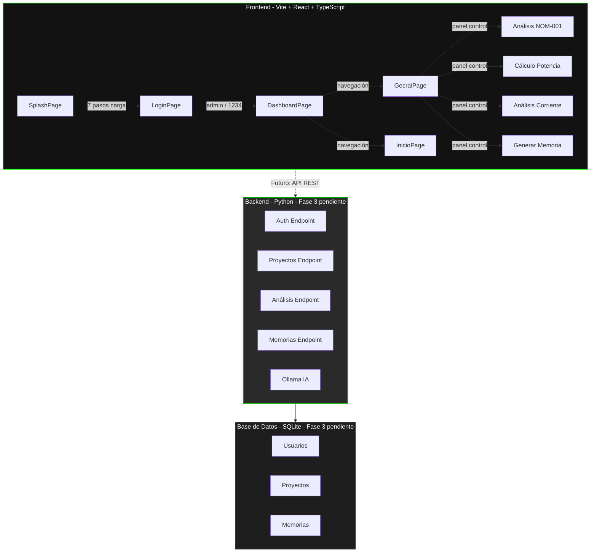

# 🎯 GECRAI - Sistema Inteligente para Memorias de Cálculo Eléctrico

Demo web del sistema **GECRAI v1.1 Pro** - Sistema Inteligente para Memorias de Cálculo Eléctrico, desarrollado por **GProA Technology**.

---

## 📂 Estructura del Proyecto

```
GECRAI/
│
├── frontend/                 # Frontend moderno (Vite + React + TypeScript)
│   ├── src/
│   │   ├── pages/            # Páginas: Splash, Login, Dashboard, Gecrai, Inicio, Error
│   │   ├── components/       # Componentes reutilizables (ProtectedRoute)
│   │   ├── types/            # Interfaces TypeScript
│   │   ├── App.tsx           # Router con react-router-dom
│   │   ├── main.tsx          # Punto de entrada React
│   │   └── index.css         # Estilos con tema GECRAI (oscuro, verde #00ff00)
│   ├── package.json
│   ├── vite.config.ts
│   └── index.html
│
├── logs/                     # Logs de ejecución (frontend.log, backend.log)
│   ├── frontend.log
│   └── backend.log
│
├── start-gecrai.ps1          # Script interactivo de PowerShell para levantar el sistema
├── README.md
├── LICENSE
└── .git/
```

---

## 🏗️ Arquitectura del Sistema



---

## 🚀 Cómo Iniciar el Sistema

### Usando el script interactivo de PowerShell (Recomendado)

```powershell
# Cambiar a codificación UTF-8 para evitar caracteres raros
chcp 65001

# Navegar al directorio del proyecto
cd "C:\Users\X1\OneDrive\Documentos\Python_VS Code\GProA\GECRAI"

# Ejecutar el script interactivo
.\start-gecrai.ps1
```

El script muestra un menú con las siguientes opciones:

| Opción | Acción |
|--------|--------|
| 1 | Levantar solo el Frontend (Vite + React en `http://localhost:5173`) |
| 2 | Levantar solo el Backend (Python) |
| 3 | Levantar todo (Frontend + Backend) |
| 4 | Detener todos los procesos |
| 5 | Ver estado actual de los procesos |
| 6 | Ver logs recientes |
| 7 | Limpiar logs |
| 8 | Verificar prerrequisitos |
| 9 | Diagnosticar frontend (puerto 5173) |
| 0 | Salir |

### Requisitos

- Node.js v24.x+
- npm v11.x+
- Python 3.x+

---

## 🖥️ Frontend (Disponible Ahora)

El frontend está listo para usar con las siguientes pantallas:

| Pantalla | Ruta | Descripción |
|----------|------|-------------|
| Splash | `/` o `/splash` | Animación de carga de 7 pasos, redirige a Login |
| Login | `/login` | Autenticación simulada (`admin` / `1234`) |
| Dashboard | `/dashboard` | Estadísticas, proyectos recientes, actividad |
| Asistente GECRAI | `/gecrai` | Panel de control (conexión a Ollama pendiente) |
| Inicio | `/inicio` | Bienvenida y opciones del sistema |
| Error | `*` | Página 404 con enlace de regreso |

### Credenciales de prueba

- **Usuario:** `admin`
- **Contraseña:** `1234`

---

## 🔧 Backend (Fase 3 - Pendiente)

El backend en Python se construirá en la Fase 3 e incluirá:

- **FastAPI o Flask** con endpoints REST
- **Autenticación real** (reemplazará la simulación actual)
- **Motor de cálculos eléctricos** (NOM-001, potencia, corriente, protecciones)
- **Base de datos SQLite** para persistencia de proyectos y usuarios
- **Generación de memorias de cálculo** (PDF/Excel)
- **Integración con Ollama** para el asistente inteligente

Cuando esté listo, Swagger estará disponible en `/docs` para probar el backend sin el frontend.

---

## 🎨 Diseño Visual

- **Tema:** Oscuro con acentos verdes (`#00ff00`)
- **Tipografía:** Helvetica, Arial, sans-serif
- **Estado:** Bastidor funcional (estructura y colores base, pulido visual pendiente)

---

## 📋 Funcionalidades Actuales

- ✅ Navegación entre 6 pantallas con React Router
- ✅ Autenticación simulada con `localStorage`
- ✅ Rutas protegidas (requieren sesión activa)
- ✅ Animación de splash con progreso de 7 pasos
- ✅ Dashboard con tarjetas de estadísticas
- ✅ Panel de control del asistente (opciones de análisis)
- ✅ Script interactivo de PowerShell con diagnóstico de puerto 5173

---

## 🔐 Seguridad

- No incluir archivos sensibles en el repositorio
- Verificar que todos los archivos sean necesarios
- Mantener una estructura limpia y organizada

---

**Desarrollado por GProA Technology** - Sistema Inteligente para Memorias de Cálculo Eléctrico
